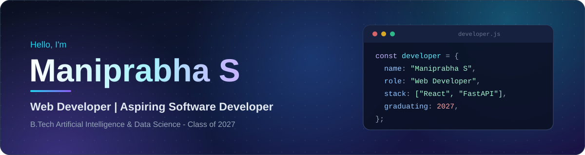
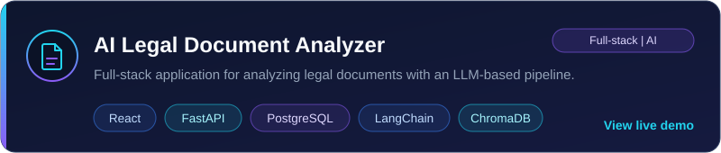
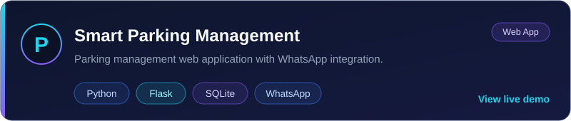
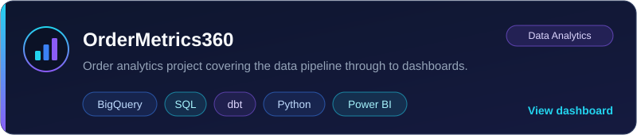

  

  
  
  

## 👨‍💻 About Me

I'm a final-year B.Tech student in Artificial Intelligence & Data Science who builds full-stack web applications, from React frontends to FastAPI and Node.js backends with SQL databases. I've worked on projects that combine web development with data and AI, and I've completed internships in MERN stack development and data analytics.

I'm graduating in 2027 and looking for opportunities to grow as a software developer.

## 🎯 Current Focus

- Building full-stack projects with **React**, **FastAPI**, and **PostgreSQL**
- Working with LLM tooling such as **LangChain** and **ChromaDB**
- Strengthening my SQL and data analytics skills
- Preparing for entry-level software developer roles

## 🛠️ Tech Stack

| | |
|:--|:--|
| **Frontend** |      |
| **Backend & APIs** |      |
| **Databases** |     |
| **Data & AI tools** |      |
| **Tools** |   |

## 🚀 Featured Projects

  Click a card to open the live project · Source for OrderMetrics360: <a href="https://github.com/maniprabha20/OrderMetrics360">GitHub repository</a>

## 💼 Experience & Learning

<table>
  <tr>
    <td valign="top" width="50%">
      <b>Internships</b>
      <ul>
        <li><b>MERN Stack Intern</b> · Yellowmatics.ai February 2026</li>
        <li><b>Data Analyst Intern</b> · Nurture Infotech July 2025</li>
      </ul>
      <b>Education</b>
      <ul>
        <li><b>B.Tech, Artificial Intelligence & Data Science</b> Velalar College of Engineering and Technology · Expected 2027</li>
      </ul>
    </td>
    <td valign="top" width="50%">
      <b>Certifications</b>
      <ul>
        <li>NPTEL: Human Computer Interaction (80%)</li>
        <li>NPTEL: Human Computer Interaction (Silver)</li>
        <li>NPTEL: Industry 4.0 (Silver)</li>
        <li>Generative & Agentic AI Workshop</li>
        <li>R Training (97.50%)</li>
      </ul>
    </td>
  </tr>
</table>

<!--
Optional: GitHub stats. Remove this comment wrapper to enable.
These cards come from a third-party service and can occasionally fail to load.

  
  

-->

## 🤝 Let's Connect

  
  
  

Thanks for visiting. Feel free to explore my projects and reach out.

